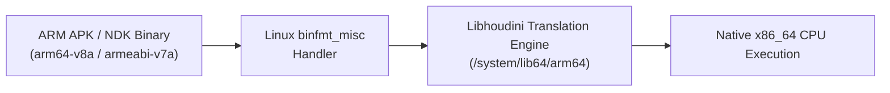

# ARM Translation with Libhoudini & Waydroid Helper

<p align="center">
  <a href="01-installation.md">← Previous: Host Installation</a> •
  <a href="../README.md">📚 Documentation Index</a> •
  <a href="03-network-inspection.md">Next: Network Inspection →</a>
</p>

---

To run Android applications compiled exclusively for ARM architectures (`arm64-v8a` and `armeabi-v7a`) on an x86_64 Linux machine, a translation layer is required. 

This guide details configuring **Libhoudini** using the recommended [Waydroid Helper](https://github.com/waydroid-helper) automated tooling.

---

## 1. How Libhoudini Translation Works



* Android native libraries (`.so`) compiled for ARM are trapped by Linux kernel `binfmt_misc` rules.
* **Libhoudini** translates ARM machine instructions dynamically into corresponding x86_64 instructions.
* The translation runs transparently without emulating an entire virtual device.

> [!NOTE]
> Libhoudini generally provides higher compatibility and performance than QEMU-based user translation for ARM64 Android workloads.

---

## 2. Why Use Waydroid Helper?

Modifying read-only container partitions manually can cause image corruption and broken OTA updates. [Waydroid Helper](https://github.com/waydroid-helper) automates extraction and installation cleanly:

* **Overlay Filesystem**: Deploys translation libraries directly to `/var/lib/waydroid/overlay/system`.
* **Clean Persistence**: System image upgrades from upstream Waydroid do not overwrite or delete your translation files.
* **Kernel Handlers**: Automatically registers and unregisters `binfmt_misc` hooks during container boot.

---

## 3. Installation Methods

### Method A: Universal CLI Script (Recommended)
This method works uniformly across any Linux distribution:

```bash
# 1. Clone the helper repository
git clone https://github.com/casualsnek/waydroid_script.git
cd waydroid_script

# 2. Prepare Python virtual environment
python3 -m venv venv
venv/bin/pip install -r requirements.txt

# 3. Stop Waydroid container before applying filesystem changes
waydroid session stop
sudo waydroid container stop

# 4. Install Libhoudini ARM translation
sudo venv/bin/python3 main.py install libhoudini
```

> [!IMPORTANT]
> The Waydroid container daemon must be stopped (`sudo waydroid container stop`) before executing the installer to ensure files are written cleanly to the overlay partition.

---

### Method B: Native GTK GUI
If your distribution provides the `waydroid-helper` package (such as Fedora or Arch Linux AUR):

```bash
# Install package
sudo dnf install waydroid-helper   # Fedora
# or paru -S waydroid-helper      # Arch Linux
```

1. Launch `waydroid-helper` from your application menu or terminal.
2. Select the **Extensions** tab.
3. Click **Install** next to **Libhoudini**.

---

## 4. Verifying Translation Support

1. Restart the container service and start a session:
   ```bash
   sudo systemctl restart waydroid-container
   waydroid session start
   ```

2. Query the supported ABI list using [ADB](https://developer.android.com/tools/adb):
   ```bash
   adb shell getprop ro.product.cpu.abilist
   ```

3. Ensure ARM architectures appear in the output:
   ```text
   x86_64,x86,arm64-v8a,armeabi-v7a,armeabi
   ```

> [!TIP]
> You can verify that an individual ARM APK runs by downloading a sample ARM64 APK and running `adb install sample_arm64.apk`.

---

<p align="center">
  <a href="01-installation.md">← Previous: Host Installation</a> •
  <a href="../README.md">📚 Documentation Index</a> •
  <a href="03-network-inspection.md">Next: 03 - Network Traffic Inspection & CA Certificates →</a>
</p>
