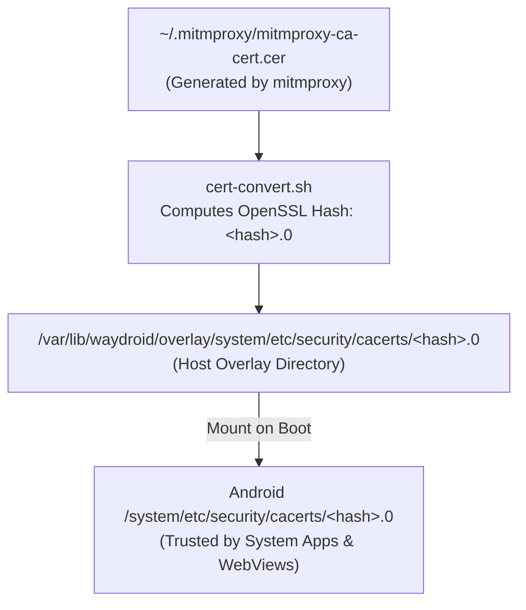

# Network Traffic Inspection & CA Certificates

<p align="center">
  <a href="02-arm-translation.md">← Previous: ARM Translation</a> •
  <a href="../README.md">📚 Documentation Index</a> •
  <a href="04-input-mapping.md">Next: Input Mapping & GPU →</a>
</p>

---

This guide details configuring [mitmproxy](https://mitmproxy.org/) to intercept and inspect HTTPS network traffic from applications running inside Waydroid.

## 📑 Table of Contents
1. [Native Overlay Architecture](#1-native-overlay-architecture-no-root-modules-required)
2. [Certificate Installation Workflow](#2-certificate-installation-workflow)
   - [Step 1: Start mitmproxy to Generate Certificate](#step-1-start-mitmproxy-to-generate-certificate)
   - [Step 2: Convert and Install Certificate](#step-2-convert-and-install-certificate)
   - [Step 3: Restart Waydroid Container](#step-3-restart-waydroid-container)
3. [Directing Android Traffic to mitmproxy](#3-directing-android-traffic-to-mitmproxy)
4. [Troubleshooting & Next Steps](#4-troubleshooting--next-steps)

---

## 1. Native Overlay Architecture (No Root Modules Required)

On modern Android versions, apps and WebViews will only trust CA certificates located in the system certificate directory:
```text
/system/etc/security/cacerts/
```

In traditional emulators or rooted devices, users often rely on Magisk modules to inject certificates. **In Waydroid, this is completely unnecessary.**



Because Waydroid mounts the host directory `/var/lib/waydroid/overlay/system` as an overlay filesystem over Android's system image, copying the hashed certificate into the overlay makes it trusted by Android natively on startup.

---

## 2. Certificate Installation Workflow

### Step 1: Start mitmproxy to Generate Certificate
Start `mitmweb` on your host machine:
```bash
mitmweb --listen-host 0.0.0.0 --listen-port 8080
```
This generates the default root certificate files inside `~/.mitmproxy/`.

---

### Step 2: Convert and Install Certificate
Use the DroidForge [`scripts/cert-convert.sh`](../scripts/cert-convert.sh) script:

```bash
./scripts/cert-convert.sh ~/.mitmproxy/mitmproxy-ca-cert.cer --install
```

**What this does behind the scenes:**
1. Extracts the legacy subject hash via OpenSSL:
   ```bash
   HASH=$(openssl x509 -inform PEM -subject_hash_old -in ~/.mitmproxy/mitmproxy-ca-cert.cer | head -n 1)
   ```
2. Renames the certificate to `<HASH>.0`.
3. Copies `<HASH>.0` into `/var/lib/waydroid/overlay/system/etc/security/cacerts/` with `chmod 644`.

---

### Step 3: Restart Waydroid Container
Apply the filesystem overlay:
```bash
sudo systemctl restart waydroid-container
waydroid session start
```

Verify that Android sees the certificate:
```bash
adb shell ls -la /system/etc/security/cacerts/
```

> [!NOTE]
> Look for your generated `<HASH>.0` in the directory listing. If present with readable permissions, Android system components will trust it immediately.

---

## 3. Directing Android Traffic to mitmproxy

Android container traffic can be directed through the host proxy using the [`scripts/proxy-toggle.sh`](../scripts/proxy-toggle.sh) utility:

```bash
# Direct traffic to host bridge IP (default 192.168.240.1)
./scripts/proxy-toggle.sh set 192.168.240.1 8080

# Check active status
./scripts/proxy-toggle.sh status

# Remove proxy settings when testing is complete
./scripts/proxy-toggle.sh clear
```

> [!TIP]
> Test your configuration by opening the Android browser inside Waydroid and navigating to:
> * `http://mitm.it` (Should display the mitmproxy installation page)
> * `https://example.com` (Should load without SSL certificate warnings and log in `mitmweb`)

---

## 4. Troubleshooting & Next Steps

If certain applications do not display traffic or fail with TLS alerts, continue to:
* [05 - Advanced Network Analysis & Troubleshooting](05-advanced-network-analysis.md) (Covering QUIC blocking and transparent proxying)
* [06 - Runtime Traffic Analysis with Frida](06-runtime-traffic-analysis-frida.md) (Covering in-memory API tracing)

---

<p align="center">
  <a href="02-arm-translation.md">← Previous: ARM Translation</a> •
  <a href="../README.md">📚 Documentation Index</a> •
  <a href="04-input-mapping.md">Next: 04 - Input Mapping & GPU Acceleration →</a>
</p>
