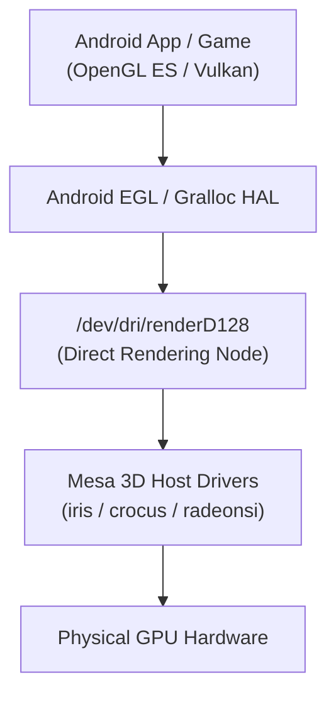

# Input Mapping & Graphics Acceleration

<p align="center">
  <a href="03-network-inspection.md">← Previous: Network Inspection</a> •
  <a href="../README.md">📚 Documentation Index</a> •
  <a href="05-advanced-network-analysis.md">Next: Advanced Network Analysis →</a>
</p>

---

This guide covers configuring Linux Direct Rendering Infrastructure (DRI) graphics acceleration and translating desktop mouse/keyboard inputs into virtual multi-touch events for Android applications.

---

## 1. Hardware Graphics Acceleration with Mesa

Waydroid relies on Direct Rendering Infrastructure (DRI) nodes exposed by the Linux kernel (`/dev/dri/renderD*`) to achieve high-performance 3D rendering.



### Verifying GPU Acceleration

1. **Verify Host DRI Node**:
   Check that your user has access to the primary render node:
   ```bash
   ls -l /dev/dri/renderD*
   ```

2. **Verify Hardware Drivers Inside Container**:
   Confirm that Android is utilizing hardware rendering rather than software rasterization (such as `llvmpipe`):
   ```bash
   waydroid shell getprop ro.hardware.gralloc
   waydroid shell getprop ro.hardware.egl
   ```
   * **Expected Result**: Should output hardware identifiers corresponding to your GPU vendor (e.g., `mesa` or vendor tags).

> [!TIP]
> You can benchmark graphics rendering inside Waydroid by installing benchmark tools such as **3DMark** or **Geekbench** through the Play Store or via ADB.

---

## 2. Desktop Input Mapping

Because mobile games and touch applications expect touchscreen coordinates rather than mouse pointers, input mappers translate desktop peripheral events into virtual touch events.

### Integrated Keymapping with Waydroid Helper
[Waydroid Helper](https://github.com/waydroid-helper) includes an integrated input mapping subsystem:

| Control Type | Functionality | Ideal For |
| :--- | :--- | :--- |
| **Directional Pad (WASD)** | Translates WASD or arrow keys into virtual joystick touches | First-person movement, racing controls |
| **Mouse Aiming** | Captures mouse pointer and maps movement to 360° screen swipes | Camera control, shooter games |
| **Single Click** | Maps arbitrary keyboard hotkeys to static screen coordinates | On-screen action buttons, abilities |
| **Multi-action Macros** | Dispatches a sequence of timed taps from a single key press | Rapid actions, combo executions |

#### Usage:
1. Launch `waydroid-helper`.
2. Open the **Key Mapping** panel.
3. Select your application from the running process list to visually place and bind on-screen control widgets.

---

## 3. Alternative Universal Input Mapping

For low-level Linux virtual device creation across different desktop environments:

* **[Phantom](https://github.com/frostasm/phantom)**: A virtual uinput mapper that creates synthetic touch/gamepad devices at the kernel level.
* **[scrcpy](https://github.com/Genymobile/scrcpy)**: Provides ultra-low-latency display mirroring with comprehensive keyboard and mouse forwarding:
  ```bash
  scrcpy --tcpip=192.168.240.112:5555 --turn-screen-off
  ```

---

<p align="center">
  <a href="03-network-inspection.md">← Previous: Network Inspection</a> •
  <a href="../README.md">📚 Documentation Index</a> •
  <a href="05-advanced-network-analysis.md">Next: 05 - Advanced Network Analysis & Troubleshooting →</a>
</p>
