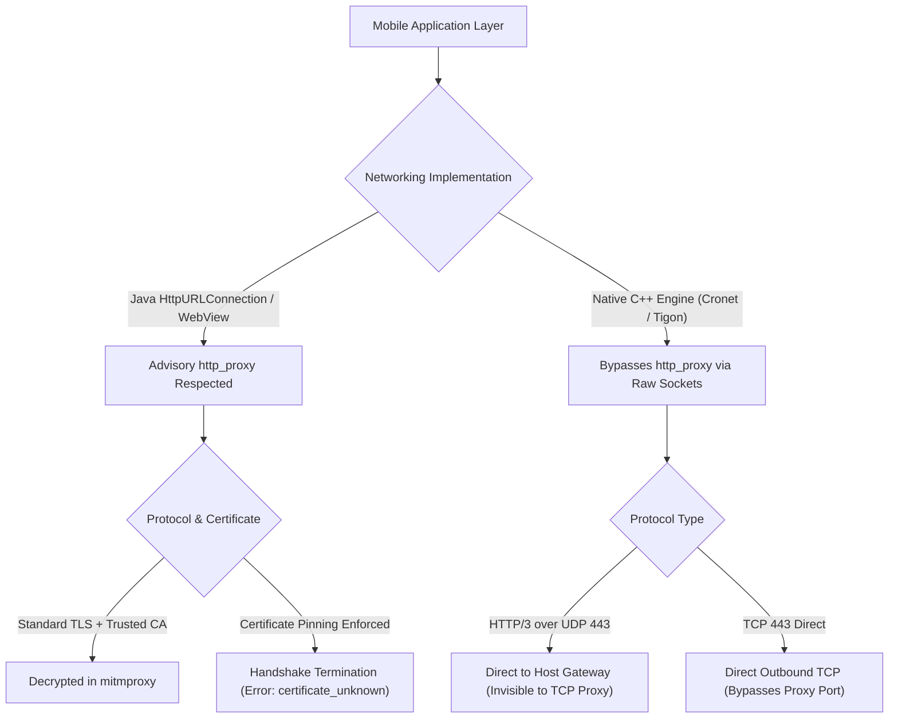

# Advanced Network Analysis & Troubleshooting

<p align="center">
  <a href="04-input-mapping.md">← Previous: Input Mapping & GPU</a> •
  <a href="../README.md">📚 Documentation Index</a> •
  <a href="06-runtime-traffic-analysis-frida.md">Next: Runtime Analysis with Frida →</a>
</p>

---

When intercepting network traffic from modern mobile applications on Waydroid, standard HTTP proxy configurations often fail to display readable requests. 

This guide details the network architecture hurdles that cause traffic to bypass or fail in [mitmproxy](https://mitmproxy.org/), and provides a systematic diagnostic workflow.

---

## 1. Why Standard Proxies Fail on Modern Apps

Unlike web browsers, complex mobile applications do not rely solely on Android's standard Java networking stack. Three primary barriers prevent standard proxy interception:



### Barrier A: Advisory Proxy Settings
Setting Android's global proxy via `adb shell settings put global http_proxy ...` is **advisory**. While standard WebViews and basic Java `HttpURLConnection` consumers adhere to it, native C/C++ networking runtimes (such as Chromium Cronet, Meta Tigon, or Flutter's Dart VM) create raw POSIX sockets directly to destination IPs, completely ignoring the Android proxy configuration.

### Barrier B: QUIC / HTTP/3 over UDP 443
Modern applications preferentially establish connections using QUIC (HTTP/3) over UDP port 443:
- Standard HTTP/HTTPS proxies only listen for TCP connections.
- UDP traffic completely bypasses the proxy and routes directly out of the `waydroid0` virtual bridge interface to the internet.

### Barrier C: Custom Certificate Pinning
Even with a CA certificate installed in the Android system trust store (`/system/etc/security/cacerts/`), production applications often validate server certificates against a hardcoded set of public key hashes (HPKP / certificate pinning). When mitmproxy intercepts the connection and presents its dynamically generated certificate, the application detects the mismatch and terminates the TLS handshake.

---

## 2. Step-by-Step Diagnostic Workflow

To identify exactly which barrier is affecting your environment, diagnose the layers from bottom to top:

### Step 1: Raw Packet Capture on Host (`waydroid0`)
Before looking at proxy logs, capture raw packets on the host bridge interface to confirm where traffic is flowing:

```bash
# Run the automated packet capture utility
./scripts/capture-traffic.sh waydroid0 waydroid_traffic.pcap
```

Open `waydroid_traffic.pcap` in [Wireshark](https://www.wireshark.org/) and apply the following display filters:

| Filter | Purpose | What to Look For |
| :--- | :--- | :--- |
| `udp.port == 443` | QUIC / HTTP/3 Traffic | If packets appear here, the app is using QUIC and bypassing your TCP proxy. |
| `tcp.port == 8080` | Proxy Traffic | Packets arriving at mitmproxy. If empty, the app is ignoring the proxy setting. |
| `tls.handshake.type == 1` | TLS Client Hello | Identifies destination SNIs (domain names) being contacted. |
| `tls.alert_message` | TLS Termination | Indicates certificate rejection (pinning failure). |

---

### Step 2: Forcing QUIC Fallback to TCP
If the application sends UDP port 443 packets, block outbound UDP 443 on the host so the application's networking stack falls back to standard TCP:

```bash
# Drop outbound UDP 443 using the helper script
./scripts/block-quic.sh enable

# Check rule status
./scripts/block-quic.sh status
```

> [!NOTE]
> With UDP 443 blocked, RFC-compliant networking libraries fall back to TCP, allowing interception tools to see the connection.

---

### Step 3: Transparent Proxy Redirection (iptables)
If the application bypasses the advisory proxy setting and connects directly to external IP addresses over TCP 443, configure transparent redirection on the Linux host:

```bash
# Enable transparent redirection of TCP ports 80 and 443 to port 8080
./scripts/transparent-proxy.sh enable 8080

# Start mitmproxy in transparent mode
mitmweb --mode transparent --listen-port 8080 --listen-host 0.0.0.0
```

> [!IMPORTANT]
> When transparent proxying is active, do not configure Android's `http_proxy`. The host kernel intercepts packets at the network layer transparently.

---

### Step 4: Distinguishing Pinning from Network Errors
Once traffic is reaching mitmproxy:

1. **Check mitmproxy Event Log**:
   * If you see `Client TLS handshake failed: Certificate verification failed`, traffic is being successfully routed to the proxy, but the application is enforcing **certificate pinning**.
   * If requests load with HTTP 200/300 responses, the system CA is accepted.

2. **When Pinning is Enforced**:
   * For applications with strict certificate pinning, standard network proxying alone cannot decrypt traffic.
   * Proceed to [06 - Runtime Traffic Analysis with Frida](06-runtime-traffic-analysis-frida.md) to inspect API calls in process memory before encryption occurs.

---

<p align="center">
  <a href="04-input-mapping.md">← Previous: Input Mapping & GPU</a> •
  <a href="../README.md">📚 Documentation Index</a> •
  <a href="06-runtime-traffic-analysis-frida.md">Next: 06 - Runtime Traffic Analysis with Frida →</a>
</p>
