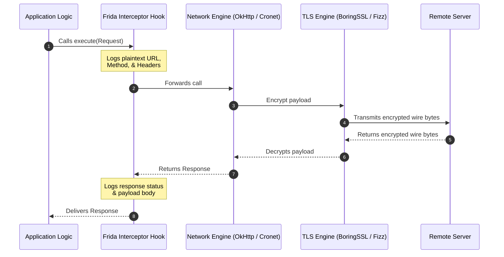

# Runtime Traffic Analysis with Frida

<p align="center">
  <a href="05-advanced-network-analysis.md">← Previous: Advanced Network Analysis</a> •
  <a href="../README.md">📚 Documentation Index</a>
</p>

---

When network interception fails due to custom networking stacks, binary serialization, or strict certificate validation, **dynamic runtime instrumentation** with [Frida](https://frida.re/) allows inspecting network activity directly from process memory.

## 📑 Table of Contents
1. [Why Use Frida for Network Analysis?](#1-why-use-frida-for-network-analysis)
2. [Deploying frida-server on Waydroid](#2-deploying-frida-server-on-waydroid)
   - [Step 1: Install Frida Tools on Linux Host](#step-1-install-frida-tools-on-linux-host)
   - [Step 2: Push and Launch frida-server in Waydroid](#step-2-push-and-launch-frida-server-in-waydroid)
   - [Step 3: Verify Connection from Host](#step-3-verify-connection-from-host)
3. [Tracing Network Calls](#3-tracing-network-calls-example-scripts)
   - [A. Tracing Java HttpURLConnection](#a-tracing-java-httpurlconnection)
   - [B. Tracing OkHttp3 Requests](#b-tracing-okhttp3-requests)
   - [C. Tracing Low-Level Socket Destinations](#c-tracing-low-level-socket-destinations)
4. [Multi-Layer Tooling Comparison](#4-multi-layer-tooling-comparison)

---

## 1. Why Use Frida for Network Analysis?

Standard network proxies sit on the wire between the client and server. If the application rejects the proxy's TLS certificate or uses direct raw sockets, the proxy cannot display plaintext traffic.

Frida operates inside the application's process space:
* **Pre-Encryption Inspection**: Captures HTTP requests, URLs, and headers before TLS encryption takes place.
* **Post-Decryption Inspection**: Reads response bodies immediately after decryption.
* **Protocol Agnostic**: Intercepts data regardless of whether the underlying transport uses TCP, UDP, or QUIC.



---

## 2. Deploying frida-server on Waydroid

### Step 1: Install Frida Tools on Linux Host
```bash
python3 -m pip install --upgrade frida frida-tools
```

### Step 2: Push and Launch frida-server in Waydroid
Use the included automated deployer script:
```bash
./scripts/setup-frida-server.sh
```

> [!NOTE]
> The [`setup-frida-server.sh`](../scripts/setup-frida-server.sh) script automatically detects whether your container runs on `arm64`, `x86_64`, `arm`, or `x86`, fetches the corresponding release, pushes it to `/data/local/tmp/frida-server`, and starts the background daemon.

### Step 3: Verify Connection from Host
From your host terminal, query the process list:
```bash
frida-ps -U
```
If active, you will see a list of Android packages and PIDs running inside Waydroid.

---

## 3. Tracing Network Calls (Example Scripts)

### A. Tracing Java `HttpURLConnection`
Log all outbound connections created through standard Java networking:

```javascript
// trace_http.js
Java.perform(function () {
    var HttpURLConnection = Java.use("java.net.HttpURLConnection");

    HttpURLConnection.connect.implementation = function () {
        var url = this.getURL().toString();
        var method = this.getRequestMethod();
        console.log("[HTTP Connect] " + method + " " + url);
        return this.connect();
    };

    HttpURLConnection.getInputStream.implementation = function () {
        var url = this.getURL().toString();
        var responseCode = this.getResponseCode();
        console.log("[HTTP Response] (" + responseCode + ") " + url);
        return this.getInputStream();
    };
});
```

Run against your target application:
```bash
frida -U -f <package.name> -l trace_http.js
```

---

### B. Tracing OkHttp3 Requests
Many modern Android applications use [OkHttp](https://square.github.io/okhttp/) as their underlying client. Log requests and headers by hooking `RealCall`:

```javascript
// trace_okhttp.js
Java.perform(function () {
    try {
        var RealCall = Java.use("okhttp3.internal.connection.RealCall");
        RealCall.execute.implementation = function () {
            var request = this.request();
            console.log("[OkHttp Request] " + request.method() + " " + request.url().toString());
            return this.execute();
        };
    } catch (err) {
        console.log("[-] OkHttp3 not found or obfuscated in target: " + err);
    }
});
```

---

### C. Tracing Low-Level Socket Destinations
When an application uses native C++ networking engines (like Cronet or Tigon) that bypass Java APIs entirely, hook the native POSIX `connect` syscall to observe destination IP addresses and ports:

```javascript
// trace_sockets.js
Interceptor.attach(Module.findExportByName("libc.so", "connect"), {
    onEnter: function (args) {
        var fd = args[0].toInt32();
        var sockaddr = args[1];
        var sa_family = Memory.readU16(sockaddr);

        // AF_INET (IPv4)
        if (sa_family === 2) {
            var port = (Memory.readU8(sockaddr.add(2)) << 8) | Memory.readU8(sockaddr.add(3));
            var ip = [];
            for (var i = 0; i < 4; i++) {
                ip.push(Memory.readU8(sockaddr.add(4 + i)));
            }
            console.log("[Native Socket] Connecting to " + ip.join(".") + ":" + port + " (fd: " + fd + ")");
        }
    }
});
```

---

## 4. Multi-Layer Tooling Comparison

| Analysis Goal | Tool / Technique | Observability Level |
| :--- | :--- | :--- |
| **Discovering Hostnames & Ports** | `scripts/capture-traffic.sh` (tcpdump) | Transport wire level |
| **Unencrypted HTTP/HTTPS Inspection** | `mitmproxy` + System CA Overlay | Network proxy level |
| **Bypassed / Native Networking Analysis** | `frida` Java & Libc Socket hooks | In-process runtime level |

---

<p align="center">
  <a href="05-advanced-network-analysis.md">← Previous: 05 - Advanced Network Analysis & Troubleshooting</a> •
  <a href="../README.md">📚 Documentation Index</a>
</p>
